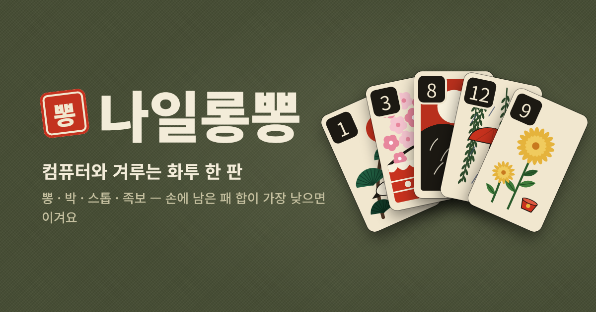

# 나일롱뽕

화투로 하는 러미 놀이 **나일롱뽕**을 웹에서 하는 게임이에요. 판이 끝날 때 손에 남은 패 숫자(월)의 합이 가장 낮은 사람이 이겨요.

**바로 하기 → https://2juwon.github.io/nylon-ppong/**



## 할 수 있는 것

- **사람들과**: 빠른 참가로 모르는 사람과 자동으로 만나거나, 방을 만들어 번호·링크로 친구를 초대
  - 빈자리는 컴퓨터가 채움, 차례마다 제한 시간(25초, 뽕 결정 10초) — 넘기면 컴퓨터가 대신 둠
  - 연결이 끊기거나 새로고침해도 같은 자리로 돌아와 이어서 하기
  - 서버가 판을 진행하고 각자에게 자기 패만 보내서, 남의 패는 개발자 도구로도 볼 수 없음
- **컴퓨터와**: 컴퓨터 1~3명(삼촌·할머니·이모)과 3·5·10판
- 뽕·박·자연바가지, 스톱, 6장 족보(또이또이·스트레이트·10 부족·60 이상·총통)
- 지역 규칙 설정: 스톱 5·10 이하, 스톱 실패 +30·+50, 바가지 +20·+30, 총통 4장 모두·4-2만, 자연뽕 점수(기본 빼 줌·그대로 셈), 4-2 자연바가지(기본 인정·일반 뽕)
- 휴대폰 화면에 맞춤
- **게임 모드**: 일반모드 / 전투모드 (혼자 하기·사람들과 모두)
  - 일반모드: 뽕할 수 있으면 할지 말지 고를 때까지 기다려 줌
  - 전투모드: 기다려 주지 않음. 버리면 바로 다음 사람 차례이고, 그 사람이 더미에서 가져가기(또는 스톱) 전에 **뽕!**을 먼저 눌러야 뽕. 늦으면 기회가 사라짐. 박·자연바가지는 자동. 버린 직후 0.7초는 다음 사람이 못 가져감. 내 화면에서는 가져오기 버튼이 0.7초(내가 뽕할 수 있으면 1.3초) 뒤에 나타나고, 버튼 자리는 미리 비워 둬서 뽕 버튼이 생겨도 화면이 들썩이지 않음
  - 전투모드는 멈추는 시간이 없어서 "저 패에 뽕이 있구나" 하고 짐작할 수 없음. 남은 시간 표시도 늘 차례인 사람 기준, 컴퓨터가 가져가는 시간도 뽕할 사람이 있든 없든 같은 범위(1~2초)
- **랭킹**: 1등 하면 오락실처럼 이름을 넣고 최종 점수를 올림. 4명이서 한 게임만(혼자 하기는 컴퓨터 3명), 판 수(3·5·10)별로 상위 100개, 누구나 볼 수 있음
  - 기본 규칙·일반모드로 한 게임만 올라감 (지역 규칙을 바꾸거나 전투모드면 제외)
  - 혼자 하기: 시작할 때 서버에서 받은 씨앗으로 판을 섞고, 내가 둔 수만 기록해 보냄 → 서버가 처음부터 다시 둬서 점수와 1등을 확인. 컴퓨터 수는 씨앗과 진행 단계로 정해져서 서버에서도 똑같이 나옴
  - 사람들과: 방 서버가 판을 끝내며 1등에게 한 번만 쓸 수 있는 표를 줌
  - 관리자 페이지(`/admin`)에서 이상한 이름·기록을 지울 수 있음
- **의견 보내기**: 고장 신고·의견을 보내면 서버에 저장. 고장 신고에는 그때 게임 상황(손패, 최근 진행 기록)을 같이 붙일 수 있음

## 규칙

[나무위키 '나이롱뽕'](https://namu.wiki/w/%EB%82%98%EC%9D%B4%EB%A1%B1%EB%BD%95) 문서를 따랐어요. 문서에 없어서 정한 부분은 아래와 같아요.

- 처음 뒤집은 패로는 뽕할 수 없음
- 뽕한 뒤 차례는 뽕한 사람의 오른쪽(반시계 방향)
- 60 이상·총통 점수는 10 부족과 같은 −100
- 다음 판 선은 그 판 점수가 가장 낮은 사람
- 손에 3장+2장일 때 3장짜리 월의 남은 1장이 버려져 4-2가 되면 자연바가지로 봄 (나무위키엔 없는 지역 규칙, 설정에서 '일반 뽕'으로 바꿀 수 있음)
- 스톱·더미 소진으로 끝날 때 손에 쥔 자연뽕(같은 월 3장)은 점수에서 빼 줌 (설정에서 '그대로 셈'으로 바꿀 수 있음)

## 파일

| 파일 | 내용 |
| --- | --- |
| `index.html` | GitHub Pages가 보여 주는 완성본 (`src`를 합친 것) |
| `src/engine.js` | 규칙 엔진. 상태는 JSON이고 `apply(state, action)`으로만 바뀜. `viewFor(state, p)`는 p가 볼 수 있는 정보만 돌려줌 |
| `src/ai.js` | 컴퓨터 플레이어. `viewFor`로 받은 정보만 사용 |
| `src/replay.js` | 랭킹 기록 확인: 씨앗과 내가 둔 수로 혼자 하기 게임을 다시 둠 (서버·테스트에서 사용) |
| `src/ui.html` | 화면, 효과음, 온라인 방 화면 |
| `src/hwatu.js` | 화투패 48장 그림 (전통 화투 구도를 따라 직접 그린 SVG, 장마다 다름) |
| `server/` | 온라인 서버 (Cloudflare Workers + Durable Objects). 방마다 같은 엔진으로 판을 진행 |
| `config.json` | 게임이 접속할 서버 주소 (`https://nylon-ppong.<서브도메인>.workers.dev`) |
| `build.js` | `src`를 합쳐 `index.html`을 만듦 |
| `test/rules.test.js` | 규칙 단위 테스트 + 컴퓨터끼리 대국 시뮬레이션 |
| `server/test/online.test.mjs` | 로컬 서버에 봇 여러 명을 붙여 방·재접속·시간 초과·정보 노출 확인 |
| `server/test/battle.test.mjs` | 전투모드: 봇끼리 뽕 경쟁, 뽕 기회가 남에게 새지 않는지 확인 |
| `og.png` | 링크 공유 미리보기 이미지 |

## 서버 배포

`server/`나 엔진이 바뀌어 `main`에 올라가면 GitHub Actions(서버 배포)가 Cloudflare에 자동으로 올려요. 저장소 Settings → Secrets and variables → Actions에 아래 두 값이 있어야 해요.

- `CLOUDFLARE_API_TOKEN` — 'Edit Cloudflare Workers' 템플릿으로 만든 토큰
- `CLOUDFLARE_ACCOUNT_ID`

- `ADMIN_KEY` — 의견함 관리자 비밀번호 (아무 긴 문자열). 의견함·랭킹 관리: https://nylon-ppong.2juwon.workers.dev/admin

배포가 끝나면 실행 결과 요약에 서버 주소가 나와요. 그 주소를 `config.json`에 넣고 `node build.js`로 `index.html`을 다시 만들면 '사람들과' 메뉴가 켜져요. 무료 플랜 한도(하루 요청 10만 건 등)를 넘으면 그날만 막히고 요금은 나가지 않아요.

## 고친 뒤

```sh
node test/rules.test.js          # 규칙 테스트 + 시뮬레이션 (Node 18 이상)
node build.js                    # index.html 다시 만들기

# 온라인 서버를 내 컴퓨터에서 확인할 때
cd server && npm install
npx wrangler dev --var FAST_TEST:1        # 다른 창에서: node test/online.test.mjs
node build.js --server=http://127.0.0.1:8787 --out=dist/local.html
```

`node build.js --artifact`는 claude.ai 아티팩트용 파일(`dist/artifact.html`, 혼자 하기만)을 만들어요.
